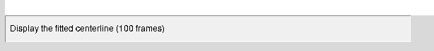
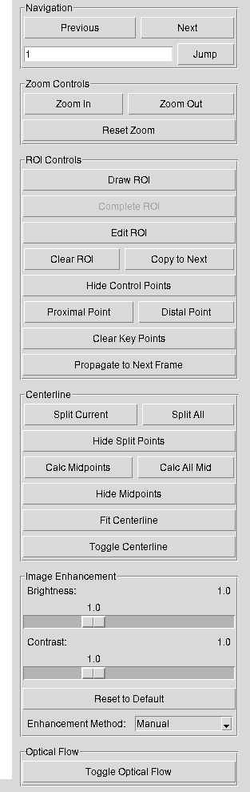
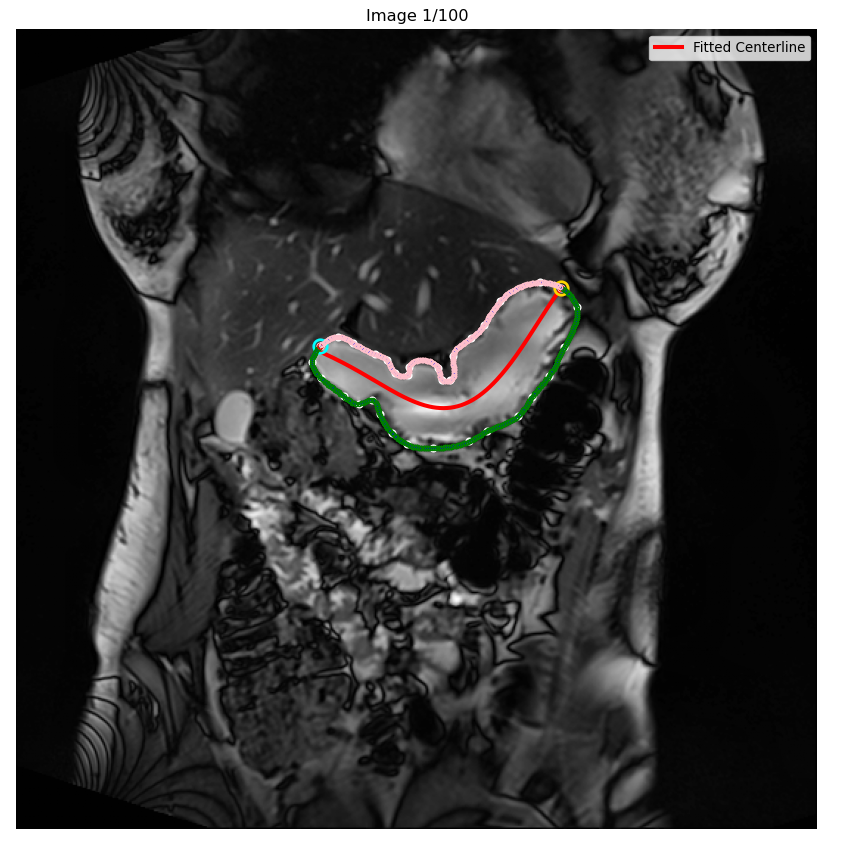
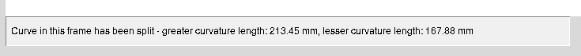
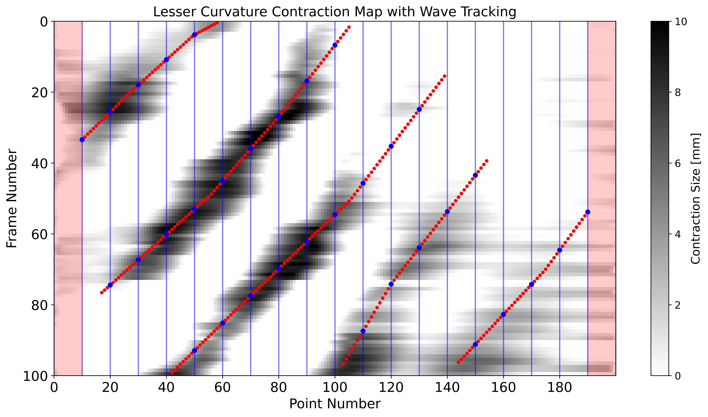
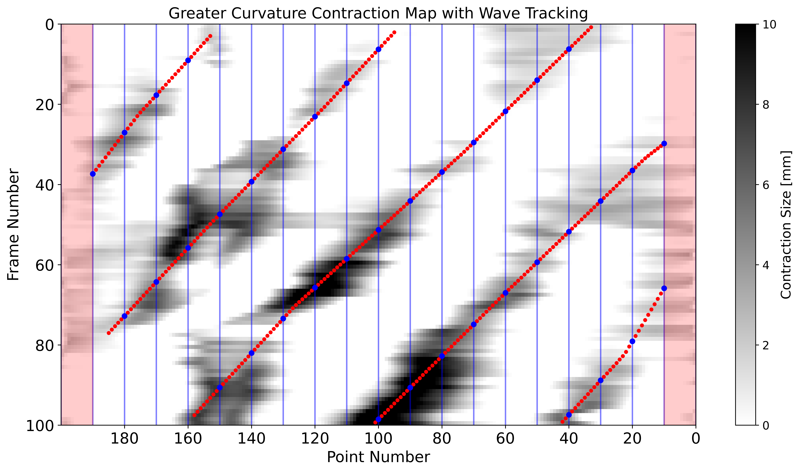

# MRI Gastric Contraction Analysis Tool - User Manual

## Overview

The MRI Gastric Contraction Analysis Tool is a specialized software application designed for analyzing gastric wall contractions from 2D MRI image sequences. It provides comprehensive tools for ROI segmentation, centerline fitting, optical flow propagation, and contraction analysis.

## System Requirements

- **Python**: 3.7 or higher
- **Libraries**: tkinter, numpy, matplotlib, PIL, scipy, opencv-python
- **Operating System**: Linux (Windows or macOS need to be tested) 

## Installation

1. Install Python 3.7+
2. Install required packages:
```bash
pip install numpy matplotlib pillow scipy opencv-python
```
3. Run the application:
```bash
python MRI Contraction Analysis Tool.py
```

## Main Interface

### Menu Bar
- **File**: Open folder, Save/Load workspace, Export images, Exit application
- **ROI**: Drawing and editing tools for region of interest, Save wall points for analysing contraction 
- **Centerline**: Polynomial fitting and visualization, Save centreline points for analysing contraction 
- **Contraction Analysis**: Lesser/Greater contraction map, Wave tracking

<center>

</center>

### Toolbar
- **Status Bar**: Current mode and operation status

  <center>
  
  </center>

### Control Panel
- Navigation controls (Previous/Next frame)

- Zoom controls (Zoom In/Out/Reset)

- ROI editing tools

- Generate and display/hide centreline

- Image enhancement controls

- Display/hide optical flow vectors

  <center>
  
  </center>

## Basic Workflow

### 1. Loading Images
- Use `File → Open Folder` to load MRI image sequences
- Supported formats: PNG, JPG, JPEG, TIF, TIFF
- Images are automatically sorted and displayed

### 2. ROI Drawing and Editing
- **Draw ROI**: Begin defining the region of interest
- **Complete ROI**: Finalize the current ROI (Ctrl+S)
- **Edit ROI**: Modify existing control points (Ctrl+E)
- **Clear ROI**: Remove ROI from current frame
- **Copy to Next**: Copy the position of ROI to next frame
- **Hide Control Points**: hide points of ROI
- **Proximal Point**: Identify the proximal key point
- **Distal Point**: Identify the distal key point
- **Clear Key Points**: Remove all key points from current frame
- **Propagate to Next Frame**: Propagate ROI points , distal point and proximal point to the next frame using optical flow method.

### 3. Centerline
- **Split Current**: Divide spline at key points from current frame

- **Split All**: Divide spline at key points from all frames

- **Toggle Display**: Show/hide split points (lesser or greater curvature has 200 points)

- **Calc Midpoints**: Calculate valid midpoints for current frame

- **Calc All Mid**: Calculate midpoints for all processed frames

- **Hide Midpoints**: Display/hide midpoint visualization

- **Fit Centerline**: Calculate polynomial centerline from midpoints of all frames

- **Toggle Centerline**: Display/hide centerline visualization

  *Red line is the centerline. Pink line is the lesser curvature. Green is the greater curvature.*

  <center>
  
  </center>

*Click split current button, the length of greater and lesser will shown in the status block*

<center>

</center>

### 3. Contraction Analysis

- Use `ROI → Save Wall Points` to export wall points location from all frames

- Use `Centerline → Save Centerline Data` to export centerline points location 

- Use `Contraction Analysis → Contraction Analysis Parameters` to set the physical length parameters

- Use `Contraction Analysis → Lesser Contraction Map` to get the lesser contraction map

- Use `Contraction Analysis → Manual Wave Tracking` to analyze contraction wave of lesser curvature. 

- Use `Contraction Analysis → Greater Contraction Map` to get the greater contraction map

- Use `Contraction Analysis → Manual Wave Tracking` to analyze contraction wave of greater curvature

  *The left side represents the distal region, and the right side represents the proximal region, regardless of whether it is the lesser or greater curvature contraction map.*

  <center>
  
  </center>

  <center>
  
  </center>

  <center>
  
  </center>

### 4. Save workspace

- Use `File → Save Workspace` to save segmenting results

### 5. Exit application

- Use `File → Exit` to exit tool

## Advanced Features

### Contraction Analysis

#### Parameter Configuration
Access through `Contraction Analysis → Contraction Analysis Parameters`:

**Pixel Spacing Settings**

- X Spacing: Physical size in mm/pixel (X-direction), Default 1.0 mm
- Y Spacing: Physical size in mm/pixel (Y-direction), Default 1.0 mm

**Average Length Parameters**

- Lesser Curvature Point Spacing: Default 1.0 mm
- Greater Curvature Point Spacing: Default 1.0 mm

**Other Parameters**

- Frame Duration: Time between frames (default 0.475 seconds)

- Max Contraction Size: Visualization limit (default 10.0 mm)

  <center>
  
  </center>

#### Analysis Types

Access through `Contraction Analysis`:

- **Lesser Contraction Map**: Analyze the lesser curvature side
- **Greater Contraction Map**: Analyze the greater curvature side
- **Manual Wave Tracking**: Interactive wave identification and tracking

### Analysis Results

#### Contraction Metrics

- **Reference Radii**: Baseline gastric wall distances
- **Contraction Sizes**: Wall movement amplitudes
- **Percentage Occlusion**: Contraction as percentage of baseline
- **Wave Propagation**: Speed and timing of contraction waves

#### Export Options

- CSV files with regional contraction statistics
- High-resolution PNG images (600 DPI)
- Numerical data in NumPy format

### Navigation

- **Previous**: Click to enter last frame
- **Next**: Click to enter next frame
- **Jump**: Enter the number of frame to jump

### Zoom Controls

- **Zoom In**
- **Zoom Out**
- **Reset Zoom**

### Image Enhancement
- **Brightness**: Adjust image brightness (0.1 - 3.0)
- **Contrast**: Adjust image contrast (0.1 - 3.0)
- **Enhancement Methods**:
  - Manual: Custom brightness/contrast
  - Histogram Equalization: Automatic contrast enhancement
  - CLAHE: Contrast Limited Adaptive Histogram Equalization

### Optical Flow

- **Toggle Optical Flow**: Show/hide optical flow vectors

## Keyboard Shortcuts

| Shortcut      | Action                      |
| ------------- | --------------------------- |
| `Left Arrow`  | Previous frame              |
| `Right Arrow` | Next frame                  |
| `Ctrl+Z`      | Undo last action            |
| `Ctrl+E`      | Enter ROI edit mode         |
| `Ctrl+S`      | Complete ROI editing        |
| `Ctrl+X`      | Propagate ROI to next frame |
| `Enter`       | Jump to specified frame     |

## File Formats

### Input Files
- **Open Folder**: Standard image formats (PNG, JPG, TIFF)
- **Load Workspace**: JSON format with ROI 

### Output Files
- **Save Workspace**: JSON format with ROI 
- **Save Wall Points**: NumPy .npz format with point types
- **Save Centerline Data**: NumPy .npz format
- **Export Images with ROIs** : PNG format with overlaid ROIs and centerlines

## Support

For technical support and bug reports, please contact:
- Email: [lsu876@aucklanduni.ac.nz]()
- License: Academic Use Only
- Version: 1.0, 2025.09.15

## References

- Hosseini, S., Avci, R., Paskaranandavadivel, N., Suresh, V., & Cheng, L. K. (2023). Quantification of the Regional Properties of Gastric Motility Using Dynamic Magnetic Resonance Images. *IEEE open journal of engineering in medicine and biology*, *4*, 38–44. https://doi.org/10.1109/OJEMB.2023.3261224

---

*Note: This tool is designed for research purposes.* In this version, centerline is calculated using all midpoints not valid midpoints.